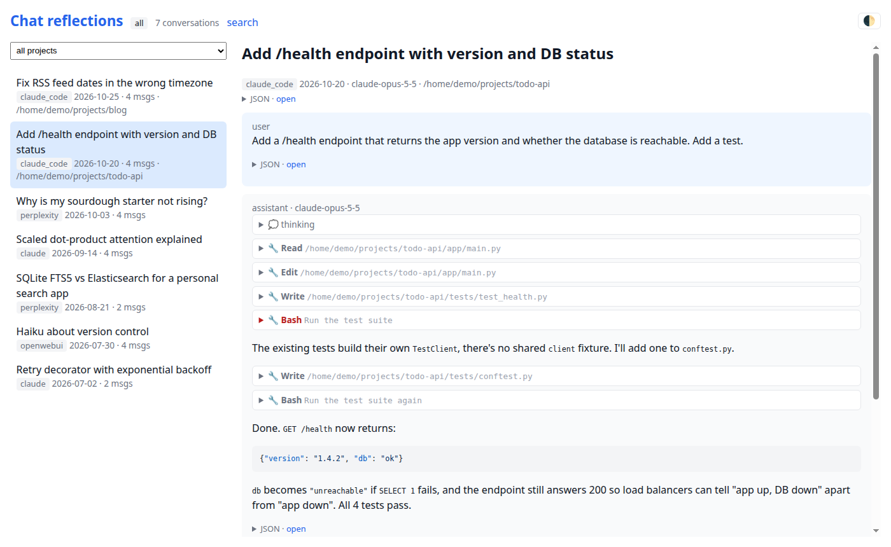
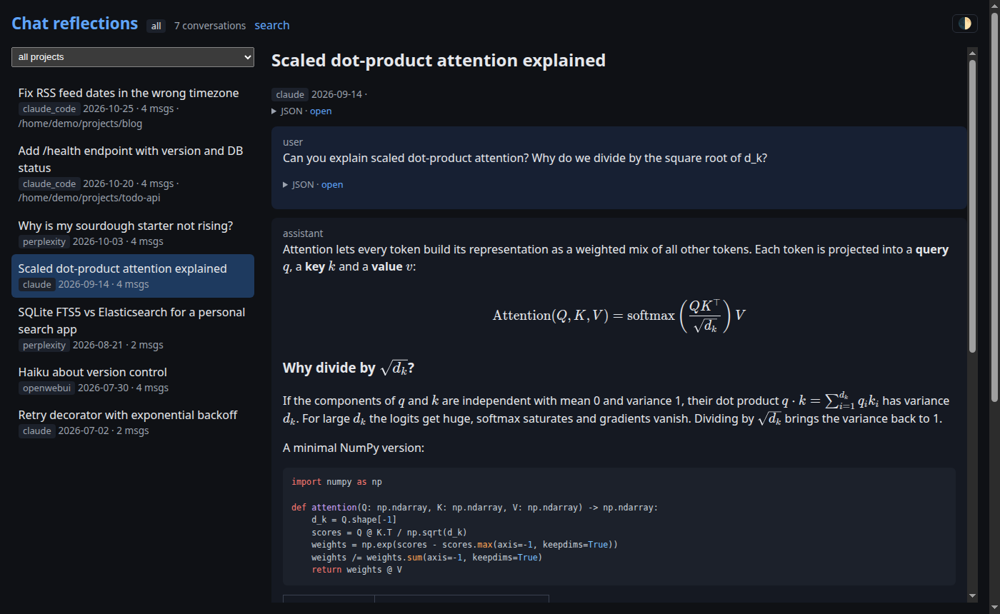

# chat-reflections

Search and browse your LLM conversation history from multiple platforms in one place —
locally, on your own machine.

Export your chats from ChatGPT, Claude, Gemini, Perplexity, Open WebUI and Claude Code, drop the files into a
folder, and get a single searchable archive with a two-pane browser, markdown/LaTeX rendering
and full access to the original export JSON.





<sub>Screenshots show the bundled synthetic [demo data](#try-it-with-demo-data).</sub>

## Features

- **One archive, many sources** — ChatGPT, Claude, Gemini, Perplexity, Open WebUI, Claude Code
- **Full-text search in your languages** — stemming for any of 40 languages at once, plus a
  language-agnostic fallback (diacritics-insensitive, works for code and names)
- **Two-pane UI** — conversation list on the left, conversation on the right; filter by source
  and, for Claude Code, by project
- **Rich rendering** — Markdown, syntax highlighting, LaTeX math (KaTeX)
- **Claude Code sessions** — thinking blocks, tool calls with their outputs and slash / `!` shell
  commands, collapsed by default
- **Images** — uploaded and generated images (ChatGPT, Gemini) shown inline, read straight from
  the export zip
- **Light and dark theme**, following your OS by default
- **Raw JSON view** for every conversation and message — the original export fragment is kept
- **Local only** — your data never leaves your machine; nothing to sign up for

## Quickstart

Requires Docker.

```sh
git clone https://github.com/pfk-beta/chat-reflections && cd chat-reflections
mkdir -p data/raw/{chatgpt,claude,gemini,perplexity,openwebui,claude_code}
# put your exports into data/raw/<source>/ (see below)

docker compose build
docker compose run --rm app chat-reflections reindex   # starts Elasticsearch, imports data/raw
docker compose up -d
```

Open http://localhost:8000.

After adding new exports, run the `reindex` command again. It rebuilds the index from scratch
in a few seconds; the files in `data/raw/` are the source of truth.

### Try it with demo data

No exports yet? The repo ships a few synthetic conversations from every source in `demo/raw/`:

```sh
docker compose run --rm app chat-reflections reindex --raw-dir demo/raw   # or: make demo
docker compose up -d
```

This replaces the current index. Run the normal `reindex` to switch back to your own data.

## Languages

Search uses English stemming by default. If you chat in other languages, list them in a `.env`
file in the project root (read by both `docker compose` and `make`):

```sh
CHAT_LANGUAGES=polish,english
```

Then run `reindex` again. Every message is indexed with each listed language's stemmer, and a
query searches all of them, so `cooking` finds "cooked" and `gotowanie` finds "gotować".
Independently of this setting, a language-agnostic [ICU](https://www.elastic.co/guide/en/elasticsearch/plugins/current/analysis-icu.html)
field matches exact words in any language and ignores diacritics (`zolw` finds "żółw").

Supported: arabic, armenian, basque, bengali, brazilian, bulgarian, catalan, chinese, cjk, czech,
danish, dutch, english, estonian, finnish, french, galician, german, greek, hindi, hungarian,
indonesian, irish, italian, japanese, korean, latvian, lithuanian, norwegian, persian, polish,
portuguese, romanian, russian, sorani, spanish, swedish, thai, turkish, ukrainian.

## Getting your exports

| Source | How to export | Put into |
|---|---|---|
| Claude | claude.ai → Settings → Privacy → Export data. Download the conversations archive from the email (`*conversations*.zip`; manifest/metadata files are ignored). | `data/raw/claude/` |
| Perplexity | Settings -> Account -> Data Export -> Export my data | `data/raw/perplexity/` |
| Open WebUI | Settings → Data Controls → Export Chats (`chat-export-*.json`). | `data/raw/openwebui/` |
| Claude Code | Sessions live in `~/.claude/projects/`. Copy them with `rsync -a ~/.claude/projects/ data/raw/claude_code/$(hostname)/` (or `make sync-claude-code`). | `data/raw/claude_code/<host>/` |
| ChatGPT | Settings → Data controls → Export data. Download the zip from the email (all `conversations*.json` shards are read). | `data/raw/chatgpt/` |
| Gemini | [Google Takeout](https://takeout.google.com) → select only **My Activity**, then *All activity data included* → only **Gemini Apps**, format **JSON**. | `data/raw/gemini/` |

Zip archives are read directly — no need to unpack.

> **Claude Code deletes sessions older than 30 days by default.** To keep them, set
> `"cleanupPeriodDays": 99999` in `~/.claude/settings.json`, and re-run the rsync regularly.
> rsync runs without `--delete`, so sessions already copied stay in your archive.

Perplexity, Gemini and Claude Code formats are not officially documented and may change. If an import
breaks, please open an issue.

## Privacy & security

- Everything runs locally. Your exports stay in `data/` (gitignored) and in a local
  Elasticsearch volume.
- **There is no authentication.** Both services bind to `127.0.0.1` only — don't expose them to
  a network.
- Claude Code sessions can contain secrets from tool outputs (env vars, tokens, file contents).
  They are stored and displayed as-is.
- The web UI loads highlight.js and KaTeX from cdnjs.

## Development

Requires [uv](https://docs.astral.sh/uv/) and Docker.

```sh
make install      # uv sync
make up           # Elasticsearch only, on localhost:9200
make reindex      # import data/raw into Elasticsearch
make demo         # import the synthetic demo data instead
make run          # dev server with reload on localhost:8000
make test         # unit tests (no Elasticsearch needed)
make test-all     # + integration tests against Elasticsearch
make lint         # ruff + pyright
```

Architecture: export files → importer (`src/chat_reflections/importers/`) → normalized
`Conversation`/`Message` → two Elasticsearch indices (conversations, messages) → FastAPI + Jinja
UI. No database: the index is derived and can always be rebuilt.

### Adding a source

Each importer is a single module exposing `GLOBS` (which files it handles) and
`parse(path) -> Iterator[Conversation]`.

1. Look at the structure of a real export (keys and types only).
2. Add a small **synthetic** fixture to `tests/fixtures/<source>/`. Never commit real
   conversations.
3. Implement `src/chat_reflections/importers/<source>.py`, register it in `importers/__init__.py`,
   and add tests to `tests/test_importers.py`. Add a demo conversation to `demo/raw/<source>/`
   (`tests/test_demo.py` checks every source has one).
4. Run `make test lint`, then `make reindex`.

The repo includes a [`CLAUDE.md`](CLAUDE.md) with architecture notes and conventions, so coding
agents (Claude Code and others) can work on it out of the box.

## Roadmap

- Semantic search (embeddings + hybrid ranking)
- MCP server, so assistants can search your history
- Dark mode, offline assets

## License

[MIT](LICENSE)
